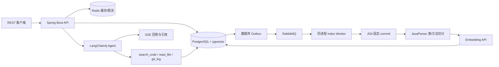

# RepoMind-Lite

Java 代码仓库问答 Agent：提交公开 Git 仓库，异步解析 Java AST 并建立向量索引；自然语言提问后，Agent 检索代码、读取文件、查询 Git 历史，通过 SSE 输出回答与文件行号引用。

个人开发的全栈 MVP：单体服务、Web 前端、三个工具、单轮问答，不包含账户系统、代码修改、多语言或多 Agent。

## 技术栈与结构

Java 17、Spring Boot 3、Maven、LangChain4j AI Services、JGit、JavaParser、PostgreSQL/pgvector、RabbitMQ、Redis、Flyway、Actuator/Micrometer、JUnit/Testcontainers。



`com.repomind.lite` 分为 `api`（HTTP/错误映射）、`application`（用例和检索）、`domain`（数据契约）、`infrastructure`（数据库、模型、Git、MQ、Redis）。API 和索引 Worker 在一个进程中。

## 启动

准备 Docker Desktop/Engine 与 Docker Compose。本机无需安装 Java/Maven，镜像内使用 Java 17。

```sh
cp .env.example .env
# 编辑 .env，设置模型 API Key 和模型名
docker compose up --build -d
docker compose ps
```

PowerShell 使用 `Copy-Item .env.example .env`。`.env` 已加入忽略列表，不要提交 Key。

| 配置 | 默认值 / 用途 |
| --- | --- |
| `LLM_BASE_URL` | `https://api.openai.com/v1`，兼容 Chat Completions、tools 和 Embeddings |
| `LLM_API_KEY` | 模型调用所需；空值允许启动，但模型操作失败 |
| `LLM_MODEL` | `gpt-4o-mini`，必须支持工具和流式输出 |
| `EMBEDDING_MODEL` | `text-embedding-3-small`，维度固定 **1536** |
| `DATABASE_URL` | 本机默认 `jdbc:postgresql://localhost:5432/repomind` |
| `DATABASE_USERNAME/PASSWORD` | 本机默认 `repomind` |
| `REPOSITORIES_WORK_DIR` | 容器内 `/var/lib/repomind/repositories`，volume 持久化 |

聊天与 Embedding 共享 API 地址和 Key。服务商需同时支持这些接口和 1536 维向量；更换 Embedding 模型不能复用旧模型向量。MVP 没有重建索引接口。

模型也可以在 Web 界面右上角的状态按钮（齿轮图标）里配置，保存到数据库的 `app_settings` 表，优先级高于上表的环境变量，无需重启。也可调用 `GET/PUT /api/settings/llm` 和 `POST /api/settings/llm/test`（测试连接，不保存）。注意：

- API Key 以明文存放在数据库，接口只返回掩码；更换接口地址时必须同时重新填写 Key，避免旧 Key 被发往新地址。
- 设置接口目前没有认证，仅适合本机或受信任网络。
- 未配置模型时，提交仓库会直接返回 `LLM_NOT_CONFIGURED`，不会入队索引。

索引失败时，`GET /api/repositories/{id}/index-status` 会返回 `errorCode`（如 `GIT_DNS_FAILED`、`GIT_TLS`、`LLM_AUTH`、`LLM_NOT_CONFIGURED`）和 `failedStage`（`CLONING`/`PARSING`/`EMBEDDING`），Web 界面据此在卡片上显示具体原因。`repomind.security.skip-ip-validation=true` 时，域名解析到回环/内网地址（例如加速器把 github.com 指向 127.0.0.1）不会被拒绝。

如果本机直连 GitHub 不通、需要走 HTTP 代理才能访问（卡片报 `GIT_UNREACHABLE`，信息类似 `Connecting to github.com (...:443) failed: Connection timed out`），设置 `GIT_PROXY=http://127.0.0.1:7897`（改成你的代理地址，仅支持 http 代理，不支持带账号密码）。克隆会通过该代理的 CONNECT 隧道进行，TLS 仍然校验 github.com 的证书。注意：应用不会自动读取 `HTTPS_PROXY`；启用后域名由代理解析，本地的内网地址检查对克隆不再生效。模型接口（`LLM_BASE_URL`）的请求不经过这个代理。实测方式：`mvn test -Dtest=PublicGitSmokeTest -Drepomind.live-git=true -Drepomind.git.proxy=http://127.0.0.1:7897`。

不再需要的仓库可以在 Web 界面卡片上点“删除”，或调用 `DELETE /api/repositories/{id}`（成功返回 204，不存在返回 404）。会同时删除索引任务、代码片段、队列记录和本地代码副本；若该仓库正在索引，进行中的任务会被中止，且无法恢复。

服务在 `http://localhost:8080`（**Web 界面**和 API）；RabbitMQ 管理在 `http://localhost:15672`（`repomind/repomind`）；就绪检查 `/actuator/health/readiness`；指标 `/actuator/prometheus`。端口仅绑定 localhost，默认密码用于本地演示。

## Web 界面

启动后访问 `http://localhost:8080` 使用 Web 界面：
- 提交仓库并实时查看索引进度
- 流式问答交互，自动显示代码引用
- 深色主题，响应式设计
- 无需额外配置，开箱即用

详见 [前端使用指南](docs/FRONTEND.md)。

## API 演示

下面示例用于 Bash；PowerShell 可用 `curl.exe` 或 `Invoke-RestMethod`。

```sh
# 1. 提交小型公开 Java 仓库，可选 ref 为分支、tag 或 commit
curl -X POST http://localhost:8080/api/repositories \
  -H 'Content-Type: application/json' \
  -d '{"repoUrl":"https://github.com/spring-guides/gs-rest-service"}'

# 2. 使用返回的 repositoryId 查询索引
curl http://localhost:8080/api/repositories/REPOSITORY_ID/index-status

# 3. READY 后流式提问
curl -N -X POST http://localhost:8080/api/repositories/REPOSITORY_ID/chat \
  -H 'Content-Type: application/json' \
  -d '{"question":"GreetingController 如何处理 HTTP 请求？请给出代码位置。"}'
```

提交返回 `repositoryId`、`jobId`、`status`。缺省 ref 使用远程 `HEAD`。同 URL + ref 的正在处理/READY 任务复用；FAILED 后重提创建新 job。只接受公开 HTTPS URL，不接受凭据、私有 IP、内部域名和重定向。实际连接重新校验并固定 DNS 地址，以原始域名校验 TLS。

索引阶段：`QUEUED → CLONING → PARSING → EMBEDDING → READY`。失败最多自动重试 3 次（含首次共 4 次），耗尽为 `FAILED`。状态响应含进度、文件/片段数、重试次数、warning 数和安全错误摘要。

RabbitMQ + 数据库 Outbox 补偿遗漏消息；消费者使用带心跳的 lease 避免重复处理，重启恢复过期任务。片段与 READY 事务提交。文件读取/历史固定在索引 commit，避免远程改动使行号失效。

| SSE 事件 | 内容 |
| --- | --- |
| `token` | 回答文本片段 |
| `citation` | 文件路径、起止行号、说明 |
| `done` | 状态、工具次数、耗时、token 用量、缓存标记 |
| `error` | 安全错误码和信息；不会再发 done |

每次问答独立，不保存会话。引用格式 `[path:Lstart-Lend]`，必须对应检索或读取证据。最终校验失败会发送 error 且不缓存；由于流式文本可能已发送，客户端应只把收到 done 的结果视为成功。

## Agent 与检索边界

- 初始检索 5 个片段；随后 AI Services 调用 `search_code`、`read_file`、`git_log`。
- 混合召回：向量与关键词各选候选，70% 向量 / 30% 归一化关键词评分；topK 1–20，严格限定当前仓库。
- 文件读取最多 200 行，拒绝绝对路径、路径穿越、`.git`、symlink；Git 历史最多 20 条。
- 最多 5 次实际工具调用（同轮多个调用逐次计数），问答总超时 30 秒，输入上下文与输出均有限额。
- 代码/注释/Git 信息作为不可信数据，不能覆盖系统指令；没有证据时说明无法确认。
- 成功答案缓存 10 分钟，key 含仓库/commit；Redis 原子 IP 限流。缓存故障可降级，限流存储故障返回明确错误。
- 最多 10,000 个 Java 文件、20,000 片段；单 Java 文件 1 MiB、checkout 256 MiB；片段约 6,000 字符。解析失败文件记录 warning。
- 失败克隆的隔离目录当前保留，长期使用需要清理失败任务目录。

## 开发与测试

本机需要 JDK 17+、Maven 3.9+，集成测试需要运行中的 Docker。

```sh
mvn test
mvn package
docker compose up -d postgres redis rabbitmq
# 设置模型环境变量，以及 REPOSITORIES_WORK_DIR=./.data/repositories
mvn spring-boot:run

# 显式网络测试：实际 GitHub 拉取与 AST，不调用付费模型
mvn -Dtest=PublicGitSmokeTest -Drepomind.live-git=true test
```

测试使用本地模型替身，不消耗模型额度，但实际运行 AI Services 工具循环、AST、SSE 生命周期；Testcontainers 验证 PostgreSQL/pgvector、RabbitMQ、Redis。Docker 不可用会明确 skip，不能据此声称集成通过。Docker Desktop API 兼容问题可尝试 `mvn -Dapi.version=1.44 test`。

Micrometer 记录索引/克隆/解析/Embedding/检索/问答耗时、失败、工具和 token 指标。日志关联 requestId/repositoryId/jobId，不输出 Key 或完整代码。真实模型验收需配置 Key 后执行公开仓库示例，检查 READY、token/citation/done 和真实文件行号；供应商未返回 token 用量时不可伪造统计。

停止使用 `docker compose down`，保留数据 volume；`down -v` 会删除已索引数据。
